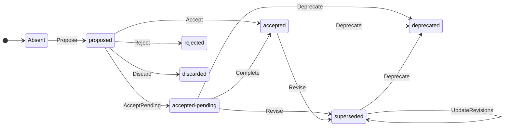

# ADR 0022: 状態と遷移を別々の代数的データ型で表す

Status: accepted

## 文脈

ある版のステータスだけを読んでも、どの判断を経てその状態になったかは分からない。
例えば直接採択した場合と、未実装として採択して後から実装した場合は、どちらも最後の行が `Status: accepted` になりうる。
二つの版で観測した変化と、一回の判断で起きる遷移を区別したい。

## 調査した事項

[src/status.rs](../../src/status.rs) の `Status` はすでに英語名の enum で、日本語と英語の値を同じ型に変換する。
`StatusLine::raw` は入力の表記を保持する。
[ADR 0016](0016-accepted-not-implemented-status.md) は、単なる採択から実装済みかどうかを推定しないと決めている。

## 実装すること

### 新しく書くステータス行

行頭の `Status: ` に続けて、小文字の ASCII トークンを一つ書く。
通常の値は `proposed`、`accepted`、`accepted-pending`、`rejected`、`discarded`、`deprecated` のいずれかで、後ろに注記を付けない。
`accepted-pending` は既存の AcceptedNotImplemented を表す。

修正済みの値だけは、トークン `superseded`、半角空白一つ、改行を含まない JSON 配列の順に書く。
配列の各要素は一つの変更を表し、`part` と `by` を一つずつ持つオブジェクトとする。
`part` は部分名を表す空でない文字列、または範囲の指定がないことを表す null とする。
`by` はリポジトリルートからの相対パスを一件以上持つ配列とする。
各パスはスラッシュ区切りで、空の要素、`.`、`..` を含めない。
外側の配列も一件以上とし、どちらの配列でも記載順を保持する。
キーの順序と JSON 内の空白は問わない。余分なキー、重複キー、末尾の注記はエラーとする。

- `Status: proposed`
- `Status: superseded [{"part":"状態の一覧","by":["docs/adr/0016-accepted-not-implemented-status.md"]}]`

読取時には新形式を先に解釈し、予約した接頭辞 `Status: superseded [` の JSON エラーを旧形式に読み替えない。
それ以外の従来の日英表記は移行中も一覧、絞り込み、修正先の追跡で読めるようにする。
`list --status` は元表記を返す。

### 新しい記述の検査

`pre-commit` は HEAD とインデックス、`check-range` は対象コミットごとの親とコミットを比較する。
初回コミットでは空のツリーと比較する。
追加したADRと、既存ADRでステータス行の内容を変更した場合に新形式を要求する。
変更のない旧行は通し、日本語の見出し、英語の見出しに続く日本語の値、自由記述による旧英語の値を新しく書いた場合はパスと行番号を示して終了コード1とする。
日本語の部分名はデータとして許す。
既存の改番で移動元と対応づくADRは元の行と比較する。
この検査は本文の変更許可とは独立して行う。
作業ツリー全体を読む `check-status` は各ADRの行数と新形式の構文を検査し、既存の旧形式を許す。

### 一度だけ使う移行スクリプト

採択後に独立した実行ファイル `scripts/migrate-adr-status` を用意する。
対象リポジトリのルートで実行し、引数なしなら変更予定の差分を表示し、`--write` で作業ツリーに適用する。
配布バイナリのサブコマンドには加えない。

スクリプトは既存の日英の値を読み、変更部分と修正先の順序を保って変換する。
旧参照の解決は [ADR 0023](0023-trace-amendments.md) と共通の規則を使う。
注記の消失、未知の値、参照先の欠落や曖昧さを検出した場合は該当パスと理由を示して終了コード1とし、書き込み前に全件の変換案を検査する。
変換済みの行は飛ばす。
ステータス行以外のバイト列と改行形式を保ち、ファイルごとに置換する。中断後は同じ引数で再開できる。

## データ構造

比較する版におけるADRの有無を `AdrState = Absent | Present(Status)` で表す。
`Absent` はその版に対象のADRファイルが存在しないときだけ使う内部状態で、ステータス行には書けない。
ファイルが存在してステータス行が欠けている場合は、既存の行数検査で違反とする。

`classify(before, after)` は観測した二状態の差を分類する関数であり、 `Unchanged | Direct(Transition) | Unclassified` を返す。
`Transition` の各コンストラクタと端点を次表で尽くす。
表では Absent 以外の状態の Present を省略する。
表中の Pending は既存の型の値 `AcceptedNotImplemented` の略記とする。

| Transition | 前 | 後 |
|---|---|---|
| Propose | Absent | Proposed |
| Accept | Proposed | Accepted |
| AcceptPending | Proposed | Pending |
| Reject | Proposed | Rejected |
| Discard | Proposed | Discarded |
| Complete | Pending | Accepted |
| Revise(origin, changes) | Accepted または Pending | Superseded(changes) |
| UpdateRevisions(old, new) | Superseded(old) | Superseded(new) |
| Deprecate(origin) | Accepted、Pending または Superseded | Deprecated |

origin は各行の「前」にある値だけを持つ直和型とする。
Deprecate の origin が Superseded のときは変更部分と修正先も保持する。
changes、old、new は変更部分と修正先を持つ変更の列（新形式の修正先はパス、旧形式は番号が欠けた元の参照も含む）で、順序も比較する。
両端が Absent の場合も Unchanged とする。
既知の状態が等しい場合は表より先に Unchanged と判定する。
片側でも Unknown なら Unclassified とし、表にない組も同じ結果にする。

### 状態遷移図

矢印は遷移表の Direct に対応し、ラベルは遷移名を示す。
`superseded` の自己遷移は変更部分や修正先の列が変わった場合を表す。
同じ状態を別の表記に移すだけの変更は Unchanged として検査を通る。

### コミット時の遷移検査

ADRを追加したとき、または既存ADRのステータス行を書き換えたとき、`pre-commit` は HEAD の状態からインデックスの状態への遷移を検査する。
新規追加では `Absent → Proposed` だけを許し、採択済みの状態を直接追加した場合は拒否する。
提案時点の内容を Git の履歴に残すため、新規ADRは最初に `proposed` でコミットし、採択や却下は後続のコミットに記録する。
新しい行が構文検査を通り、分類結果が Unchanged または Direct のときに遷移検査を通す。
Unclassified の場合は、ADRのパス、変更後の行番号、変更前後の値を標準エラーに示す。
違反が一件でもあれば終了コード1でコミットを止める。
`--allow-status` と `ADR_GUARD_ALLOW` はこの検査を免除しない。
`check-range` でも各コミットの差分に同じ規則を適用する。

旧形式を移行するときは、変更部分と修正先の順序を保ち、旧参照を移行前のツリーで解決したパスと新形式のパスを比較する。
例えば `ステータス: 提案` から `Status: proposed` への移行は Unchanged として通る。
旧行をそのまま残す場合は遷移検査を行わない。
旧行の値が Unknown で書き換えた場合は、遷移元を判定できないため違反とする。

## 実装しないこと

複数コミットをまたぐ中間状態の推定、本文の翻訳は対象外とする。
削除の可否は既存の削除検査で扱う。削除を正当な状態遷移として追加しない。

## 不変条件

1. Direct(t) から復元した端点は、入力の両端と等しい。
2. 既知の同一状態は表記によらず Unchanged になる。
3. 未知の状態を含む組と、既知の異なる状態で表にない組は Unclassified になる。
4. 旧形式の行は既存の行と同一の場合に限り差分検査を通る。
5. 移行を二度適用した結果は一度の結果とバイト単位で等しい。
6. 既存ADRの行を書き換えた場合、遷移検査は Unclassified のときに限り失敗する。

| 前 | 後 | 結果 |
|---|---|---|
| Absent | Proposed | Direct(Propose) |
| Absent | Accepted | Unclassified |
| 空の値 | 空の値 | Unclassified |
| 提案 | Proposed | Unchanged |
| Pending | Accepted | Direct(Complete) |
| Accepted | Proposed | Unclassified |
| Superseded の修正先が一件 | 同じ部分の修正先が二件 | Direct(UpdateRevisions) |

## テスト設計

`inv1_direct_endpoints` で表の各行と各 origin を往復させる。
`inv2_equivalent_spellings` は日英の同値例と同一の変更列を、`inv3_unclassified_pairs` は境界表と全状態の直積のうち未定義の組を調べる。
`inv4_new_syntax` は追加、据え置き、旧形式への書き換え、改番をフックとCIで照合する。修正先が零件、一件、二件の境界も検査する。
`inv5_migrate_twice` は旧日英表記、複数部分、同番号の別モジュール、CRLF を含む入力で差分と二度目の無変更を確認する。変換不能な一件を混ぜた場合は全ファイルのバイト列を比較する。

`inv6_pre_commit_transition` は一時リポジトリにフックを設定し、実際に `git commit` を実行する。
`accepted-pending` から `accepted` への変更と同じ状態への英語化は成功し、`accepted` から `proposed` への変更は失敗して HEAD が動かないことを確かめる。
後者ではステージ後に作業ツリーだけを `accepted` に戻し、診断がインデックスの `proposed` を示すことも確かめる。
フックを省略して作った同じ違反コミットは `check-range` で検出する。

`inv1_propose_new_adr` は空のリポジトリと既存リポジトリの両方で、新規ADRの `proposed` を許し、`accepted`、`absent`、ステータス行なしを拒否することをフックとCIで確かめる。改番だけの変更は元の状態を引き継ぐ。

## トレードオフ

`accepted-pending` は、決定をすでに採択し、その実装が残っていることを表す。
候補の `not-implemented` は実装状況だけを示し、採択の有無が名前から分からない。
そこで、採択を示す `accepted` を先頭に置き、実装待ちを `pending` で表す。
`pending` だけでは何を待つかが曖昧なので、この仕様では待つ対象を実装に限る。
実装を終えたときは `accepted-pending` から `accepted` に移るが、最初から `accepted` とだけ書かれたADRの実装状況は不明のままとする。

修正先のパスは番号より長くなるが、部分名に句読点や引用符を含む入力も JSON の規則で一意に読める。
一方、二つの版から得た Direct は一回で説明できる変化を示すにとどまり、実際の操作回数は確定しない。

## 参考文献

- [ADR 0012](0012-status-line-and-status-adt.md)
- [ADR 0016](0016-accepted-not-implemented-status.md)
