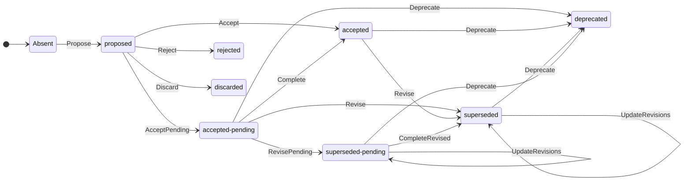

# ADR 0025: 新形式のステータス行に、実装待ちの修正、補足、注記、別のリポジトリの修正先を加える

Status: accepted

## 文脈

[ADR 0022](0022-status-transitions.md) は、ステータス行の新形式を定めた。
修正を受けたADRは `Status: superseded [<変更の配列>]` と書き、変更の各要素は `part`（部分名）と `by`（修正先のパスの配列）だけを持つ。
`by` のパスはリポジトリのルートからの相対パスに限り、余分なキーと末尾の注記はエラーとする。

[ADR 0024](0024-migration-dry-run-and-error-count.md) の `--dry-run` で、dotfiles を除く tett23 のリポジトリを調べた。
そのうち10件のADRは、旧形式のステータス行が持つ情報を、いまの新形式では表せない。
新形式に移すと、その情報が落ちる。
この ADR は、それらの情報を新形式で表せるように、新形式を拡張する。

## 調査した事項

`main`（`91317a0`）でビルドした `scripts/migrate-adr-status --dry-run` を、dotfiles を除く tett23 のリポジトリのうちADRのある21個で実行した。
移行できないADRは74件あった。
そのうち次の10件は、ステータス行に書かれた情報を、いまの新形式のどの欄にも置けない。
各行の全文を読んで分類した。

| 種類 | 件数 | ADR | 旧形式の行に書かれている情報 |
|---|---|---|---|
| 実装待ちのまま修正を受けた | 4 | golem `docs/adr/0221`、sofel `docs/adr/0022`、`0027`、`0029` | `採択（未実装）→照合の期限は [ADR 0226](…)` のように、採択して実装を待つ状態と、修正先の両方 |
| 補足 | 2 | novel-crawler `docs/adr/0027`、`0030` | `目次のない作品の扱いは補足（[ADR 0031](…)）`。後のADRが置きかえずに書き足したこと |
| ADR自身の注記 | 1 | golem `docs/golem-layout/adr/0034` | `採択（`wrap-mark` の既定は `"⏎"`（U+23CE）とした。…ため。…）→…`。実装のときに決めたことと、その理由の3文 |
| 別のリポジトリの修正先 | 3 | tett23 `.github/docs/adr/0002`、`0005`、`0006` | `[tett23.github.io ADR 0001](https://github.com/tett23/tett23.github.io/blob/main/docs/adr/…)`。別のリポジトリのADRへの URL |

`src/status.rs` の `parse_canonical_value` は、`superseded ` の後の JSON を `part` と `by` だけの要素の配列として読む。
`Status` には、実装待ちと修正の両方を表す値がない。
旧形式の `採択（未実装）→…` は、`採択（未実装）` を先に判定するので、`AcceptedNotImplemented` として読まれる。

ほかに、移行できない74件のうち8件（golem）は、修正先の後ろに `で消した`、`が改めた`、`（位置とメトリクスはフォントの単位で返す）` のような注記を持つ。
これらは部分名に組みこめば移せるが、この ADR の注記の欄があれば、注記のまま移せる。

## 用語

この ADR では次の語を使う。

- 変更：ステータス行の JSON 配列の一つの要素。[ADR 0022](0022-status-transitions.md) の「変更」と同じ。
- 種類：変更が、元のADRの部分を置きかえたもの（置換）か、置きかえずに書き足したもの（補足）か、修正先を持たない記録（注記）か。
- 修正先：変更の `by` の各要素。

## 実装すること

### 新しい状態 `superseded-pending`

- ステータスの値に `superseded-pending` を加える。採択して実装を待つADR（`accepted-pending`）が、後のADRの修正を受けた状態を表す。
- 書き方は `superseded` と同じく、トークン、半角空白一つ、改行を含まない JSON 配列の順とする。
  - `Status: superseded-pending [{"part":"照合の期限","by":["docs/adr/0226-move-the-iso-15930-7-check-to-before-v1.md"]}]`
- `Status` に `SupersededPending(Vec<Change>)` を加える。
- [ADR 0022](0022-status-transitions.md) が `Status: superseded [` を予約したのと同じく、`Status: superseded-pending [` も予約する。この接頭辞に続く JSON のエラーは、旧形式（`Superseded…`）に読み替えずにエラーとする。
- `adr-guard unimplemented` は、`accepted-pending` に加えて `superseded-pending` のADRも一覧する。

### 変更の要素の拡張

変更の要素に、次の2つのキーを加える。
どちらも省いてよい。
省いたときの意味は、[ADR 0022](0022-status-transitions.md) の書き方と同じになる。

- `kind`：種類。`"replace"`（置換）、`"supplement"`（補足）、`"note"`（注記）のいずれか。省いたときは `"replace"` とする。
- `note`：注記。空でない、改行を含まない文字列。

種類ごとの決まりは次のとおりとする。

| 種類 | `by` | `note` | 例 |
|---|---|---|---|
| 置換 | 1件以上 | 省いてよい | `{"part":"toolsRequiredBy","by":["docs/adr/0092-remove-tools-required-exports.md"],"note":"消した"}` |
| 補足 | 1件以上 | 省いてよい | `{"part":"目次のない作品の扱い","by":["docs/adr/0031-hameln-short-and-toc-supplement.md"],"kind":"supplement"}` |
| 注記 | 0件 | 必須 | `{"part":"wrap-mark の既定","by":[],"kind":"note","note":"U+23CE とした。…"}` |

ほかの決まりは [ADR 0022](0022-status-transitions.md) のままとする。
キーの順序と JSON 内の空白は問わない。
余分なキー、重複キー、種類と合わない `by` の件数、注記の種類での `note` の欠落はエラーとする。
外側の配列は1件以上とする。

補足や注記だけを持つADRも、`superseded` か `superseded-pending` で書く。
状態の名前は「修正を受けた」より広い「変更が記録された」を表すことになる。

### 別のリポジトリの修正先

- 修正先は、リポジトリのルートからの相対パスか、`https://` で始まる URL とする。
- URL の修正先は、存在を確かめず、たどらない。
- `Change::by` の要素を、`Target = Path(String) | Url(String)` で表す。

### 状態遷移

[ADR 0022](0022-status-transitions.md) の遷移表に、次の行を加える。
既存の行は変えない。

| Transition | 前 | 後 |
|---|---|---|
| RevisePending(changes) | Pending | SupersededPending(changes) |
| UpdateRevisions(old, new) | SupersededPending(old) | SupersededPending(new) |
| CompleteRevised(changes) | SupersededPending(changes) | Superseded(changes) |

また、Deprecate の origin に SupersededPending を加え、変更の列も保持する。
CompleteRevised は、前後の変更の列が等しいときだけとする。
変更の列が違えば Unclassified とする。
変更の列の比較には、種類と注記も含める。
種類を省いた要素と `"kind":"replace"` を書いた要素は等しいとみなす。

図の矢印は遷移表の Direct に対応する。
`superseded-pending` を通る3本の矢印と、`superseded-pending` から `deprecated` への矢印が、この ADR で加えるものである。

### 旧形式から新形式への遷移の判定

旧形式の行を新形式に書きかえるとき、[ADR 0022](0022-status-transitions.md) は旧参照を移行前のツリーで解決したパスと新形式のパスを比べる。
この ADR では、次を加える。

- 旧形式の参照のリンク先が `https://` で始まる URL なら、そのURL を修正先とし、新形式の URL と文字列として比べる。
- 旧形式の行から得た変更の種類は、すべて置換とし、注記は持たない。そのため、補足や注記を加えた新形式の行への書きかえは、UpdateRevisions（前が Superseded の場合）か、Revise と RevisePending（前が Accepted か Pending の場合）になる。

### 移行スクリプト

`scripts/migrate-adr-status`（[ADR 0022](0022-status-transitions.md)、[0024](0024-migration-dry-run-and-error-count.md)）は、次の2つを自動で移す。

- `採択（未実装）→…` と `Accepted (not implemented)` に続く `→…` の行を、`superseded-pending` に移す。修正先の読み方は `採択→…` と同じとする。
- 旧形式の参照のリンク先が `https://` で始まる URL なら、その URL を修正先とする。

補足と注記は自動で移さない。
旧形式での書き方がリポジトリごとに違い、規則として読めないためである。
これらは、`--dry-run` が移行できないと報告したADRとして残り、人か AI がステータス行を新形式で書く。

### trace

[ADR 0023](0023-trace-amendments.md) の `trace` を次のように変える。

- `superseded-pending` のADRも、`superseded` と同じく修正先を展開する。
- `--list` の各行の後ろに、第5列として種類（`replace`、`supplement`、`note`）、第6列として注記を加える。`root` の行では両方を空にする。第1列から第4列は変えない。
- 注記の種類の変更は、第3列（修正先のパス）を空にした `edge` の行を1行出す。
- URL の修正先は、第3列に URL を出し、その先を展開しない。
- `--graph` では、補足に ` (補足)` を、注記に `: <注記>` を付ける。置換の注記は ` (<注記>)` を付ける。URL の修正先は葉とする。

### 文書

README と `docs/specifications.md` の新形式の説明と、状態遷移と、`trace` の出力の説明を直す。

## 実装しないこと

- 補足と注記の旧形式の書き方を、移行スクリプトで読むこと。
- URL の修正先の存在の確認と、別のリポジトリのADRの展開。
- 新しいトークン（たとえば `amended`）で、補足や注記だけを持つADRを表すこと。
- [ADR 0022](0022-status-transitions.md) の Revise（Pending から Superseded）をなくすこと。実装と修正を一度に記録したADRがありうるので、残す。
- 注記をステータス行の外（本文など）に移すこと。コミット済みのADRの本文は変えられない。

## 不変条件

1. 読める新形式の行は、キーの順序と JSON 内の空白を変えても、同じ `Status` として読まれる。
2. 種類を省いた要素と `"kind":"replace"` の要素は、同じ変更として読まれる。
3. 注記の種類の要素は、`by` が0件で `note` があるときだけ読める。置換と補足の要素は、`by` が1件以上のときだけ読める。
4. `superseded-pending` と `superseded` の両方で、`unimplemented` は前者だけを一覧する。
5. 遷移の分類は、拡張した表の各行の両端を往復し、表にない組を Unclassified にする。
6. `trace --list` の全行は6列で、第1列から第4列は [ADR 0023](0023-trace-amendments.md) の4列の出力と等しい。
7. URL の修正先を持つADRの `trace` は、URL を葉として出し、終了コード0で終わる。

| 入力 | 期待 |
|---|---|
| `Status: superseded-pending [{"part":null,"by":["docs/adr/0002-b.md"]}]` | SupersededPending、修正先1件 |
| `Status: superseded-pending []` | エラー（外側の配列が0件） |
| `{"part":"a","by":[],"kind":"note","note":"n"}` | 注記として読める |
| `{"part":"a","by":[],"kind":"note"}` | エラー（`note` がない） |
| `{"part":"a","by":[]}` | エラー（置換の `by` が0件） |
| `{"part":"a","by":["docs/adr/0002-b.md"],"kind":"note","note":"n"}` | エラー（注記の `by` が1件） |
| `{"part":"a","by":["https://example.com/adr/0001.md"]}` | URL の修正先として読める |
| `{"part":"a","by":["http://example.com/adr/0001.md"]}` | エラー（`https://` ではない） |
| `{"part":"a","by":["docs/adr/0002-b.md"],"kind":"other"}` | エラー（未知の種類） |
| `{"part":"a","by":["docs/adr/0002-b.md"],"note":""}` | エラー（空の注記） |
| Pending → SupersededPending | Direct(RevisePending) |
| SupersededPending(x) → Superseded(x) | Direct(CompleteRevised) |
| SupersededPending(x) → Superseded(y)、x ≠ y | Unclassified |
| SupersededPending → Accepted | Unclassified |
| Accepted → SupersededPending | Unclassified |

## テスト設計

テストの名前には、`amend_inv` に続けて不変条件の番号を入れる。

- `amend_inv1_key_order`：上の表の読める入力と、注記に引用符、バックスラッシュ、日本語を含む入力について、キーの順序と JSON 内の空白を変えた行が同じ `Status` として読まれることを確かめる。
- `amend_inv2_default_kind`：種類を省いた要素と `"kind":"replace"` の要素が等しく、遷移の分類が Unchanged になることを確かめる。
- `amend_inv3_kind_and_by`：上の表のエラーの入力が、`check-status` と pre-commit でエラーになることを確かめる。
- `amend_inv4_unimplemented`：`accepted-pending`、`superseded-pending`、`superseded` のADRを置き、`unimplemented` が前の2つだけを出すことを確かめる。
- `amend_inv5_transitions`：拡張した表の各行と、境界の表の遷移の組を `classify` に通す。一時リポジトリで実際に `git commit` を実行し、`accepted-pending` から `superseded-pending` を経て `superseded` に移す順のコミットが通り、`accepted` から `superseded-pending` へのコミットが止まることを確かめる。
- `amend_inv6_trace_columns`：置換、補足、注記、URL の修正先を持つADRで、`trace --list` の全行が6列であり、第1列から第4列が変わらないことをバイト単位で確かめる。
- `amend_inv7_trace_url`：URL の修正先が葉として出て、終了コード0で終わることを、両方の形式で確かめる。
- 移行スクリプト：`採択（未実装）→…` の行が `superseded-pending` に、URL のリンク先を持つ行が URL の修正先に移ることと、`--dry-run` を二度実行して結果が変わらないことを、`tests/migrate_status.rs` に足す。

既存のテストは、`trace --list` の列数を見るものを除いて変えずに通す。
列数を見るものは6列に直す。

## トレードオフ

- 補足と注記だけを持つADRも `superseded` と書く。名前が表す範囲は広がるが、同じ状態を表すトークンを2つにしないことを優先する。補足と注記は、種類の欄で区別できる。
- `superseded-pending` を状態として加える。代わりに、変更の配列を `accepted-pending` の後ろに書けるようにする案もある。しかし、その案では `accepted` の後ろにも配列を許すかが問題になり、`superseded` と同じ意味の書き方が2つになる。
- `trace --list` に列を加えるので、列数を数える使い方は変わる。列の順で値を取る使い方（`awk -F '\t'` の `$1` から `$4`）は変わらない。
- 注記は自由な文であり、検査しない。旧形式の自由な注記を許さなかった [ADR 0022](0022-status-transitions.md) の方針を、欄を分けたうえで緩める。注記の欄を持たないと、実装のときに決めたことの記録（golem `docs/golem-layout/adr/0034`）が、移行で落ちる。
- URL の修正先は存在を確かめないので、リンク切れを検出しない。別のリポジトリをたどるには、そのリポジトリの取得が要り、検査が手元の作業ツリーだけで閉じなくなる。

## 参考文献

- [ADR 0016](0016-accepted-not-implemented-status.md)
- [ADR 0022](0022-status-transitions.md)
- [ADR 0023](0023-trace-amendments.md)
- [ADR 0024](0024-migration-dry-run-and-error-count.md)
- `main`（`91317a0`）の `src/status.rs`（`parse_canonical_value`、`classify`）
